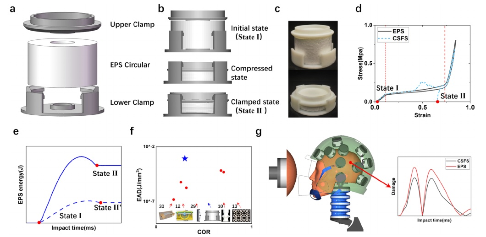

## Abstract

Most existing bistable Metamaterials are based on the buckling behavior of slender beams or thin shells, making it difficult to simultaneously achieve high energy absorption and effective rebound suppression under impact conditions. In helmet protection systems, an energy-absorbing layer that combines high energy absorption with rebound suppression capability can help reduce brain strain and lower the risk of traumatic brain injury. To address this, this study designed a Composite Snap-Fit Structure (CSFS) integrated with expanded polystyrene (EPS), which combines the high energy absorption characteristics of EPS with the rebound suppression function of the bistable CSFS. By systematically optimizing the geometric parameters of the CSFS, an inverse design framework was established, achieving precise matching of target impact energy (error ≤ 8%). Results demonstrate that the structure significantly improves impact dynamic response through its bistable rebound suppression mechanism: impact duration was shortened by 20.83%, rebound acceleration peak was reduced by 15.34%, and the maximum reduction in peak angular acceleration reached 38.22%. Helmet Test Protocol results show that the structure reduces peak brain strain by over 19%, with injury risk reductions of 9.21% – 19.39% at five key impact locations, providing an innovative solution for impact protection design.
